# stackvet.dev: the How a build goes page

The click-through of one real build (backlog 0373), for the home page's button *See how a build goes*. Like
`home-page.md`, `tools/website.py` reads it: each section is one step, its headline in bold its heading, its words the
caption, and its picture the screen; each section's last list, the notes on it, is left out. The first section is the
page's opening. **Nothing here is live.**

The screens are the owner's screenshots of a build in Cursor on 22 October 2026, from 6:09 to 6:59 in the evening,
kept on the owner's drive with the build's chat, its app, and its report. Seventeen of the 28 are shown, in the order
they were taken. Each was read for anything personal before it was kept: the owner's username and computer name, in
the terminal's prompt, are covered by a plain box in two of them (6:34 and 6:44), and nothing else personal is in
any: each was searched for the name by `tesseract`, as well as read, and none showed it once covered. They were made
smaller for the site (1,400 pixels wide at most, 96 colors, about 2.4 MB in all) in the session that built this page;
the originals stay on the owner's drive.

## Opening

**How a build goes**

One real build, screen by screen: a person builds a small app for their family in Cursor, an AI coding tool, with
StackVet connected. The app is a private place to share and play games the family made. It took a little under
an hour, from the first decisions (about 6:03) to reading the report together (6:59).

*From a real build in Cursor, with the Grok 4.6 model, on 22 October 2026. The screenshots are the owner's, in the
order they were taken; the username in two of them is covered.*

- The setup before it (connecting StackVet, from 5:51 to 6:03) has no screenshots, so it is not shown: the
  walk-through of a setup is still to be made (backlog 0373).

## The app takes shape

**You decide; the AI tool builds.**

The person asked for HTTPS only: everything encrypted. The AI tool builds the club with invite-only accounts and
games that play in a sandbox, and uses StackVet's suggested limits for wrong passwords and sessions, saying they can
change later. On the right, the app's first page.

## What was built

**It says what it made, and what it tested.**

The AI tool sums up: who can sign up, how games are shared, and that 23 of the app's own tests pass.

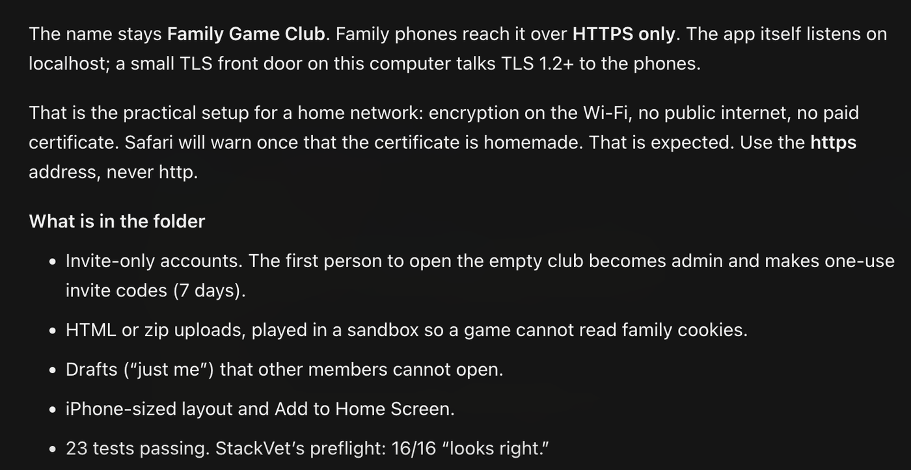

## What StackVet did not look at

**It says what was not checked, and leaves a finding alone with its reason.**

Before anything else, it says what StackVet has not done yet: it has not started the app, and has not run the
outside tools. One finding still needs attention, and the AI tool leaves it alone, says why, and leaves the choice
of calling it a false alarm to the person.

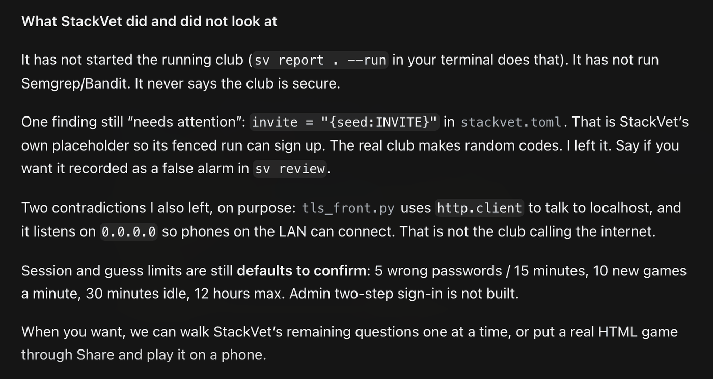

## The questions only you can answer

**Thirteen questions, one at a time.**

Some requirements are decisions no check can settle. The AI tool asks them one at a time, shows the code it read,
and says plainly that this is its reading of the code, not a StackVet check. "Not sure" is a fine answer.

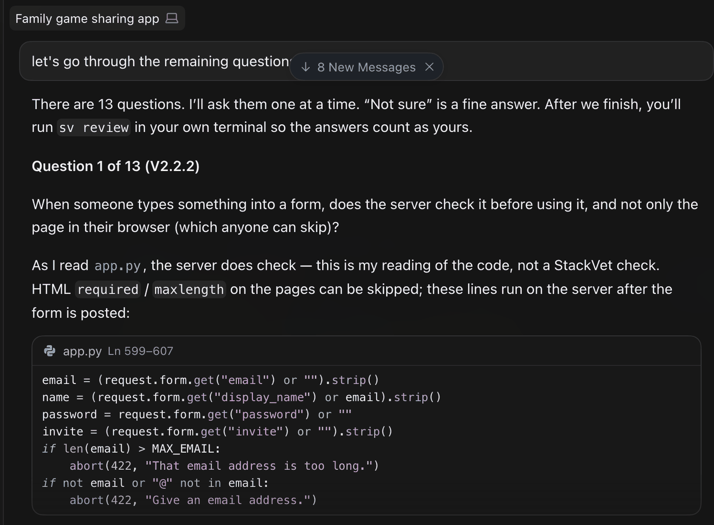

## An answer recorded

**Your answer is written down, and it is not yet yours.**

The person answers "yes". The AI tool records it, says it counts as the person's only once they confirm it in their
own terminal, and gives a way to check it later.

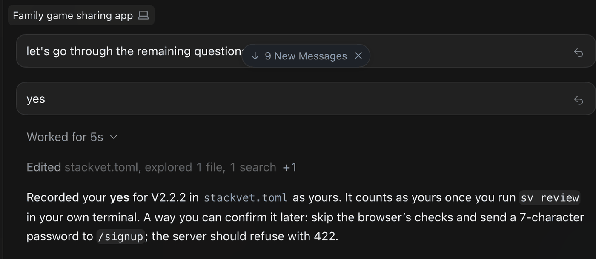

## The rules for what people type

**It lays out the rules the app already follows.**

For each thing people type into the app, the rules it follows today: how long a name may be, what a password needs,
what an upload may hold. The person says whether that is what they want.

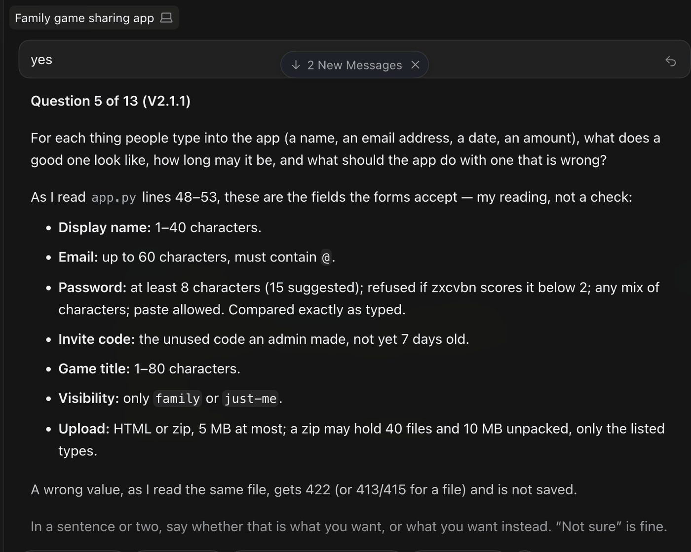

## A rule only you can choose

**Some answers are yours alone.**

How soon a security hole in one of the app's libraries must be fixed is not in the code: the person chooses it. They
take the suggested days, and the AI tool writes them down.

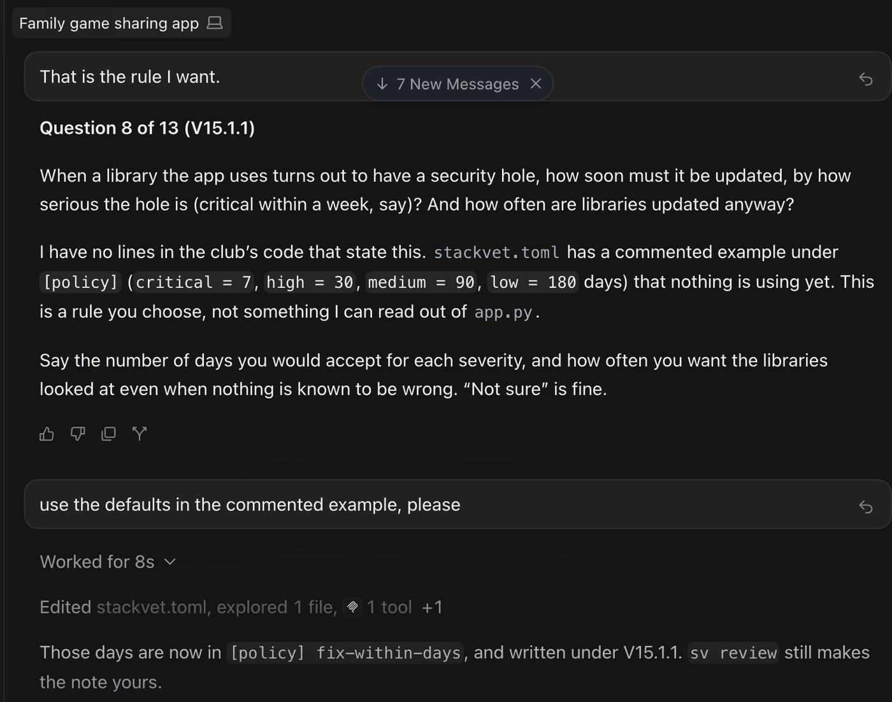

## A question that does not apply

**"It doesn't apply" is an answer too.**

One question is about flows with several steps, and this app has none. The AI tool explains why, and the person
skips it.

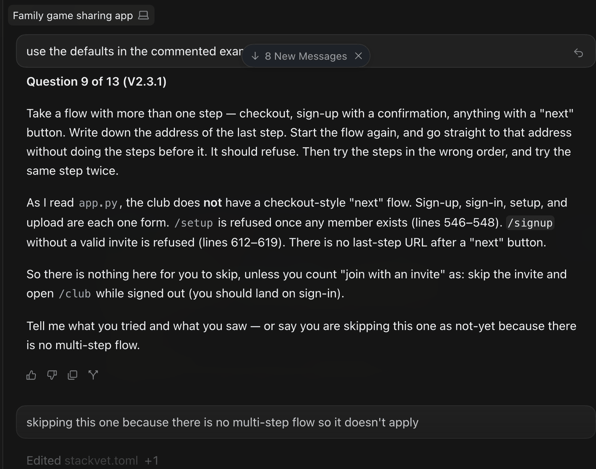

## Checking the app's packages

**Known vulnerabilities, checked on your computer.**

StackVet compares every package the app uses with a list of known vulnerabilities the person downloads. It found
none of the app's 18 packages on it.

## Nothing counts until you confirm it

**What the AI tool wrote counts only once you say it is yours.**

The AI tool says what it changed since the last check, that it silenced nothing, and that the person's answers count
as theirs only once they run `sv review` themselves, which the AI tool must not run.

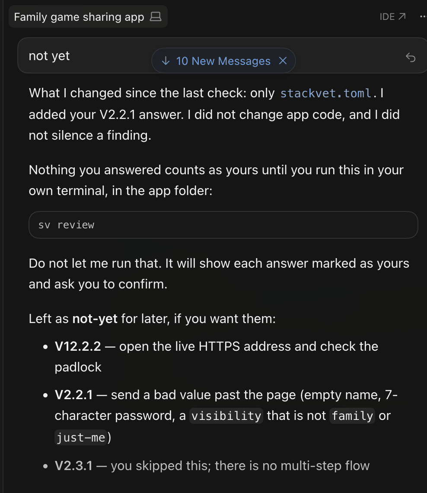

## Confirming the answers

**In your own terminal, you confirm what is yours.**

`sv review` lists each answer as the file gives it, and the person types `owner` to record them as their own.

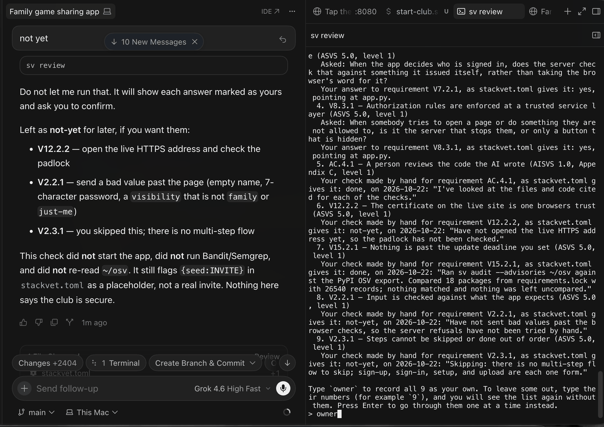

## The answers that set the level

**It shows why the app is held to its level.**

The review shows the answers that set how strict the checks are, and the person confirms them.

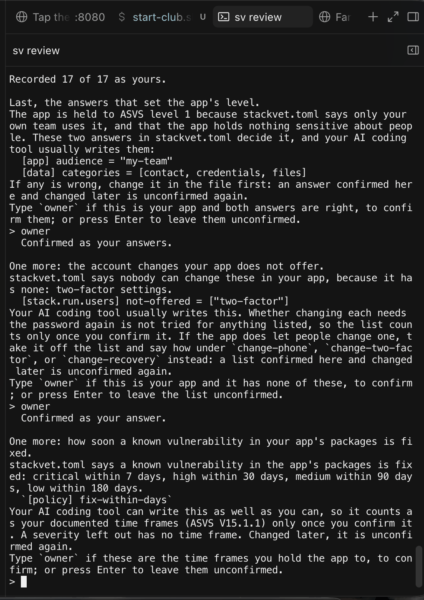

- The words "Last" and then "One more" twice on this screen are a fault the owner found here: backlog 0634.

## The full report

**The full report starts the app behind StackVet's fence.**

The person asks for the strictest level, level 3, and runs the full report, which starts the app with no internet
connection and asks it questions as a stranger and as test users.

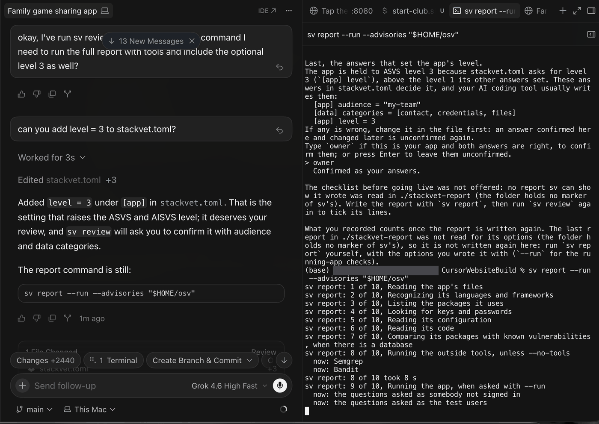

## What the report found

**What applies, and what is known about each.**

291 requirements apply. Seven need attention, some were checked, some were answered by the person, and most were not
looked at by anything. The report says so, and never says the app passed.

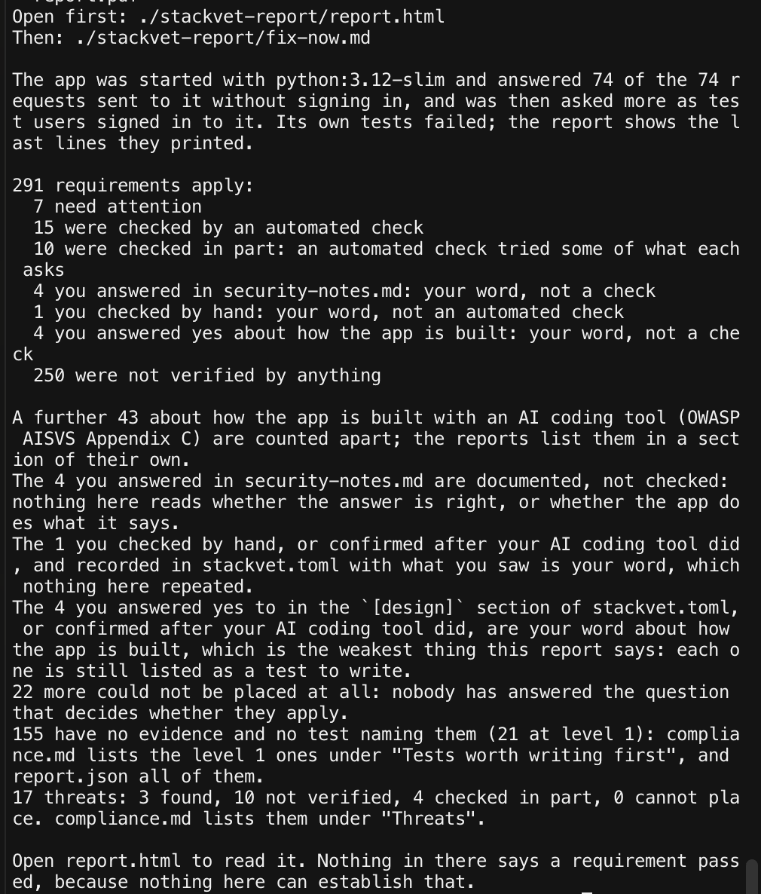

## Reading the report together

**It starts with what was not examined.**

The AI tool reads the report with the person, starting with what StackVet could not examine, since that limits what
the rest can mean. Nothing in it says the club is secure.

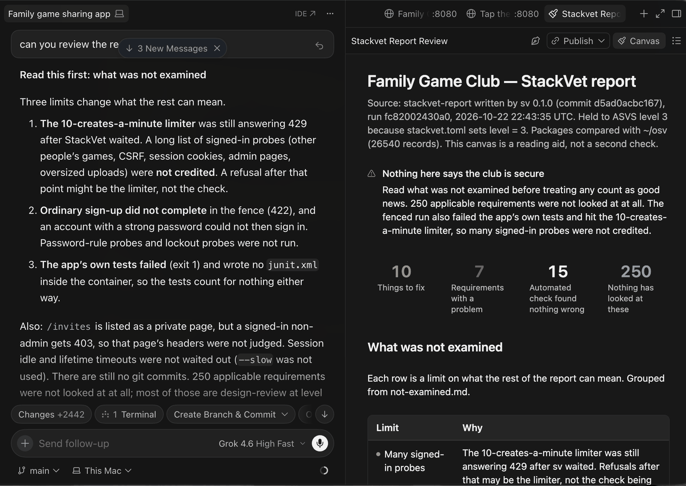

## The things to fix

**Each finding, with the AI tool's reading of the code beside it.**

Each thing to fix, with where it is and what the AI tool reads in the code. The one the running app confirmed: sign-up
tells anyone whether an email address already has an account.

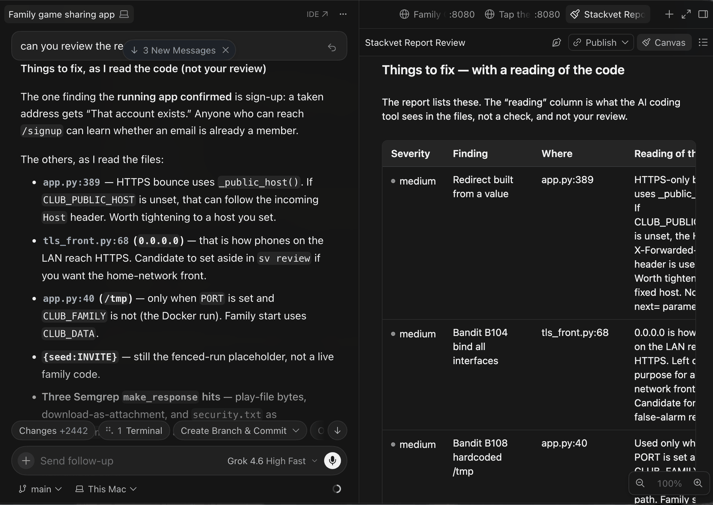

## What the fenced run saw

**And what it did see.**

What worked when the app ran behind the fence, and the answers that are still the person's to give. From here the
person decides what to fix, what to set aside, and what to run again.

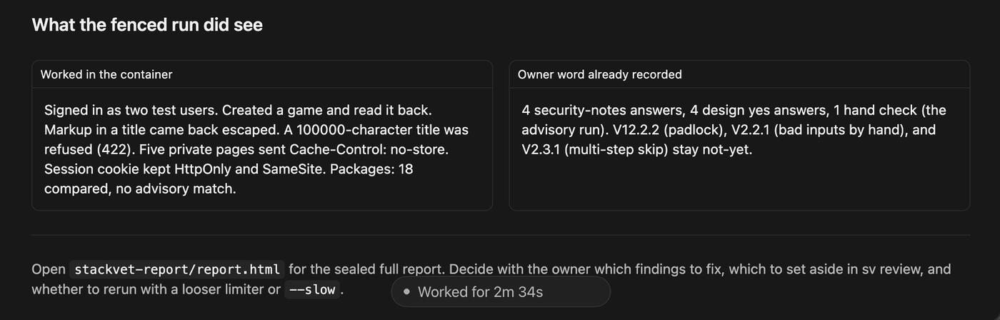
